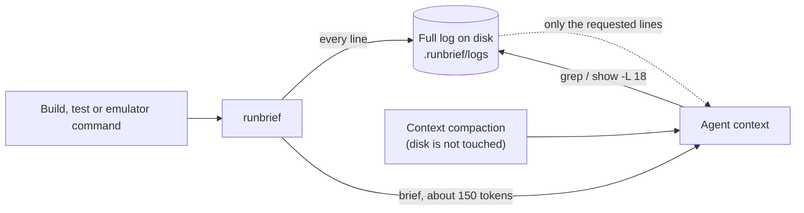
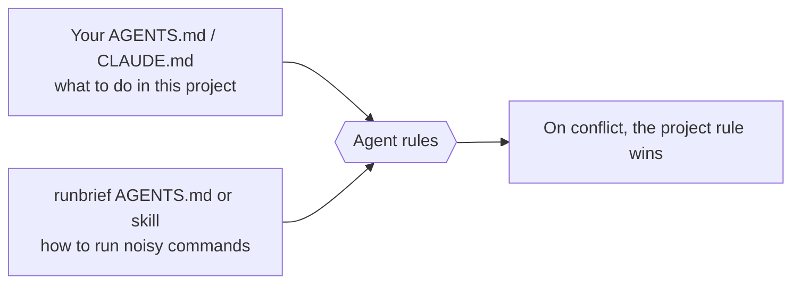
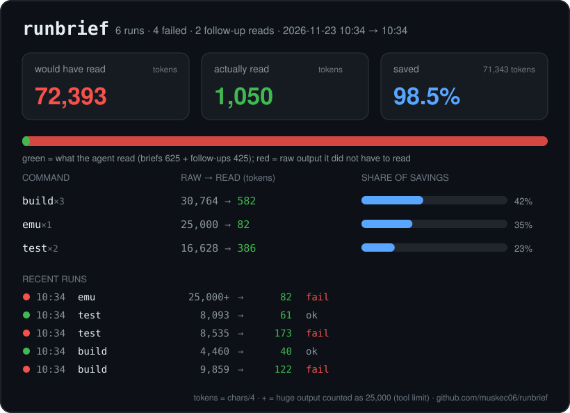

<div align="center">

# runbrief

**Run noisy commands, hand your AI agent a brief.**

[](https://github.com/muskec06/runbrief/actions/workflows/ci.yml)


[](LICENSE)


[Watch in HD (MP4, 35 s)](docs/runbrief-demo.mp4) · [Türkçe README](README.tr.md)

</div>

`runbrief` runs a build, test suite, emulator or simulator, keeps the full output in a
log file, and gives the agent a short, root-cause-first summary. The agent opens the log
only when the summary is not enough, and only the lines it needs.

One Python file, no dependencies, Python 3.10+, Linux / macOS / Windows. It works with
Claude (chat, skills, Claude Code) and any agent that can run shell commands.

---

## Why

A coding agent re-reads the whole conversation on every turn. A 600-line verbose build log
costs its tokens once when it arrives, and again on every following turn of the
session. Most of that log is progress lines, compiler command lines and the same error
repeated per translation unit. What the agent actually needs is usually two lines.

```text
$ runbrief -n build -- "make -C build VERBOSE=1 -k -j2"
[runbrief] build: FAIL exit=2 | 6.2s | 607 lines | errors 2 (74 hits) | warnings 0 | log .runbrief/logs/build-...-fail.log
errors (first-seen order, showing 2/2):
  L18: include/regs.h:5:59: error: 'MASK_ALL' was not declared in this scope  [x73]
  L502: src/periph/uart.cpp:6:68: error: 'baud_divisor' was not declared in this scope
build-system: 75 failure line(s), first L26: make[2]: *** [...op_000.cpp.o] Error 1
more: runbrief grep 'REGEX' -n build  |  runbrief show -n build -L <line> -C 20
```

The raw output of that build was **16,638 tokens**; the brief is **149**. The 73 copies of the
header error became one line with a count, and the 75 `make: *** Error` lines became one
"consequence" line, so the second, unrelated bug in `uart.cpp` is not buried.

## How it works

The full output goes to disk, a short brief goes to the agent, and the agent pulls exact lines
back only when it needs them. Line numbers in the brief stay valid after a context summary,
because the log is not part of the context.



runbrief's rules sit next to your own project rules; they only say *how* to run noisy commands:



## Results

Measured with [`bench/run_bench.py`](bench/run_bench.py) on real tool output (gcc 13.3,
clang 18.1, CMake 3.28, GNU Make 4.3, ninja 1.11, pytest, Python 3.13; Linux, 2 CPUs).
Each scenario was run twice, raw and through runbrief.
*Fidelity* = root-cause markers (the file:line or message a developer needs) present in the brief.
Full briefs: [`bench/results/results.md`](bench/results/results.md).

| Scenario | Raw lines | Raw tokens | Brief tokens | Reduction | Fidelity | Time raw / runbrief (s) |
|---|---:|---:|---:|---:|:-:|---:|
| C++ emulator, CMake + `make VERBOSE=1 -k`, header bug + uart bug | 607 | 16,638 | 149 | 99.1% | 2/2 | 6.27 / 7.04 |
| Same project fixed, `-Wall -Wextra`, `ninja -v` (success) | 135 | 7,064 | 41 | 99.4% | 1/1 | 7.61 / 7.47 |
| clang++ template errors (`unique_ptr` copy, `std::sort` on map) | 96 | 2,739 | 254 | 90.7% | 3/3 | 0.67 / 0.41 |
| g++, same file | 54 | 1,599 | 197 | 87.7% | 3/3 | 0.28 / 0.34 |
| Linker: undefined reference | 3 | 39 | 52 | **-34.8%** | 1/1 | 0.06 / 0.12 |
| `pytest -v`, 400 tests, 3 failures | 448 | 8,534 | 172 | 98.0% | 4/4 | 0.57 / 0.62 |
| Python emulator config loader: 800 log lines then `KeyError` | 811 | 12,519 | 77 | 99.4% | 2/2 | 0.07 / 0.09 |
| MSBuild / C#, 40 projects *(replayed fixture, see below)* | 332 | 15,746 | 189 | 98.8% | 2/2 | 0.00 / 0.07 |
| Emulator trace, 200k lines, `FAULT` in the middle | 200,001 | 3,850,018 | 84 | >99.99% | 1/1 | 1.50 / 1.69 |
| Same trace, bug line has **no error keyword** | 200,001 | 3,850,020 | 245 | >99.99% | 1/1 | 1.42 / 1.61 |
| Same, plus one line in `.runbrief/patterns.txt` | 200,001 | 3,850,020 | 88 | >99.99% | 1/1 | 1.08 / 1.86 |
| Simulator that never exits, `-T 8`, 20 MB log cap | 4,120,002 | 60,770,012 | 85 | >99.99% | 1/1 | 8.00 / 8.17 |

**Builds and tests only (first 8 rows): 64,878 → 1,131 tokens, 98.3% less. All 12 scenarios: 22/22 root-cause markers kept.**

What the numbers mean in a session: the CMake failure above, left in context for 10 more
turns, is re-read as ~166,000 tokens raw versus ~1,500 as a brief (simple arithmetic, before
any prompt-caching discount).

How to read the table honestly:

- **Tokens are estimated as bytes / 4** for both columns, so the *reduction* does not depend
  on the estimate; absolute counts for a specific model's tokenizer will differ.
- **Tiny outputs cost a little more** (the linker row): outputs under 40 lines / 4 KB are passed
  through verbatim with a one-line header, which adds ~13 tokens. That is deliberate: it is lossless.
- **Time overhead** is within run-to-run noise for builds (the compiler dominates; one ninja run
  was even faster through runbrief) and about 1-2 µs per line for line-heavy traces
  (200k lines: +0.1 to +0.4 s).
- **MSBuild** rows replay a fixture in MSBuild's real output format (MSBuild prints every
  diagnostic twice: during the build and in the summary); no .NET SDK was available on the host.
  Emulator/simulator rows are generator scripts producing realistic trace formats.
- Re-run everything with `python3 bench/run_bench.py`; CI does it on every push.

## What runbrief itself costs

Using the tool is not free either, so here is its own footprint (measured file sizes, bytes/4):

| How you use it | One-time cost per conversation | Ongoing cost |
|---|---|---|
| Prompt + `git clone` (chat) | `AGENTS.md` ≈ 1,020 tokens + clone/install output ≈ 40 | none |
| claude.ai skill | — | skill description ≈ 70 tokens in every chat; `SKILL.md` ≈ 690 when it is used |
| Claude Code install | — | `CLAUDE.md` rules ≈ 240 tokens per session (cached); a blocked raw command costs one extra short turn |

The rules tell the agent **not** to read `runbrief.py` (≈ 9,100 tokens) or this README
(≈ 5,400): running the script needs neither. Break-even is the first noisy command: one
failing CMake build above saves ≈ 16,500 tokens against a setup cost of ≈ 1,060.

## Does it make the agent worse?

It is designed not to, and the benchmark checks it:

- **Root cause first.** Errors are listed in first-seen order (the first error is usually the
  real one), with repeat counts `[x73]`, cascade lines (`make: ***`, `ninja: build stopped`,
  `Build FAILED`, `collect2: ld returned`) counted separately.
- **The useful line, not the noisy one.** C++ template errors reported inside `stl_algo.h`
  get the user line attached: `... error: no match for 'operator-' ... (from bus.cpp:11)`.
  Python tracebacks become one line with the exception and the last frame in *your* code,
  not in the standard library.
- **Nothing is thrown away.** The full log stays on disk; `runbrief grep` and
  `runbrief show` fetch exactly the lines needed, with stable line numbers even after trimming.
- **Unknown formats are not silently missed.** If no pattern matches, the brief shows a
  compacted tail, plus "rare lines": lines whose shape appears at most twice in an
  otherwise repetitive output. In the benchmark this found
  `uart0: unexpected register value CR1=0x0000DEAD` in a 200,000-line trace with no
  error keyword at all. One regex in `.runbrief/patterns.txt` makes it a first-class error.
- **Small outputs pass through unchanged**, so commands whose output *is* the answer still work.

## Quick start

### Claude in the browser or app (cloud chat with code execution)

Paste as the first message of a new chat:

```text
Before anything else: git clone --depth 1 --branch v1.1.0 https://github.com/muskec06/runbrief /tmp/runbrief
and follow /tmp/runbrief/AGENTS.md for this whole conversation (run its setup step).
Task: <your task>
```

No GitHub access in that environment? Attach `runbrief.py` and `AGENTS.md` instead and say
*"Use the attached runbrief.py and follow AGENTS.md for this whole conversation."*

**Already deep in a conversation?** Use prompt B in [`PROMPT.md`](PROMPT.md): it starts saving
from that point and writes a `HANDOFF.md`, so you can move to a fresh chat and reclaim the space
the old output still occupies.

Or upload [`dist/runbrief-skill.zip`](dist/runbrief-skill.zip) once as a skill
(Customize › Skills › + › Create skill › Upload a skill) and start chats with *"Use the runbrief skill."*
A real, step-by-step skill session with every command and output: [`docs/skill-example.md`](docs/skill-example.md).

### Claude Code

```bash
python3 integrations/claude-code/install.py /path/to/project   # add --windows on Windows
```

This installs runbrief into `.claude/runbrief/`, adds the rules to `CLAUDE.md`, and adds:

- **a hook** that blocks raw `make`, `cmake --build`, `ninja`, `msbuild`, `dotnet build/test`,
  `pytest`, `gcc`, `qemu-system-*`, `renode`, `west`, `idf.py`, `cargo build` and similar commands, and
  tells Claude to re-run them through runbrief. Already-limited commands
  (`| tail`, `> file.log`), git commands and quoted text pass. Prefix with `RAW=1` to bypass.
- **a context watch** that asks Claude to update `HANDOFF.md` and suggest `/compact` when the context
  passes 50%. This is a fallback, because `CLAUDE_AUTOCOMPACT_PCT_OVERRIDE` is unreliable in several Claude Code versions.
- **a status line** with the context percentage.
- **read-deny rules** for `build/`, `obj/`, `*.o`, `*.elf`, `*.map`, `*.pdb` and the log folder.

Commit the result so every session, including cloud sessions, starts with it.

### Any other agent or plain shell

```bash
python3 runbrief.py install          # puts `runbrief` on PATH
runbrief -n build -- "cmake --build build -j8"
```
Add [`AGENTS.md`](AGENTS.md) to your agent's rules file. More prompts are in [`PROMPT.md`](PROMPT.md).

## Commands

| Command | What it does |
|---|---|
| `runbrief [-n NAME] [-T SEC] -- "<cmd>"` | Run, log, print brief. Exit code is preserved (124 on timeout). |
| `runbrief grep REGEX [-n NAME] [-C 2] [-m 30]` | Search the latest log of NAME (or `--log PATH`, `.gz` works). |
| `runbrief show -L LINE [-n NAME] [-C 20]` | Lines around a line number from the brief. |
| `runbrief stats [--svg FILE] [--since H] [--json]` | Savings dashboard (net of grep/show follow-ups), or a shareable SVG card. |
| `runbrief clean` / `install [DIR]` | Delete logs / put `runbrief` on PATH. |

Useful run options: `-H N` also print the first N lines (for big output you must read), `-e N` max errors (20), `-c N` lines of context after each error,
`-w` list warnings on success, `-t N` tail lines, `--json` machine-readable brief.
A single quoted string runs through the shell (`&&`, pipes, env vars).

## Linux commands: what to wrap, what not

runbrief is for output you want *diagnosed*. Output that *is* the answer should be limited
with the tool's own options instead; otherwise the brief would hide it.

| Wrap with runbrief | Limit natively instead |
|---|---|
| `make`, `cmake --build`, `ninja`, `gcc`/`clang`, kernel modules (`make -C /lib/modules/$(uname -r)/build M=$PWD`) | `cat`, `ls`, `tree`, `git diff/log/show`, `env`, `ps` |
| `pytest`, `ctest`, `dotnet test`, `npm test` | `grep -rn -m 50`, `rg -m 50`, `find . -maxdepth 3 \| head -100` |
| `apt-get install`, `dnf install`, `pip install`, `npm install`, `./configure`, `docker build` | `journalctl -p err -n 100 --no-pager`, `dmesg --level=err,warn \| tail -100` |
| `qemu-system-*`, `renode`, `west flash`, `idf.py`, your simulator (`-T SEC`) | a script that prints a result |
| `valgrind`, ASan/UBSan runs, long scripts | |

Recognised Linux failure lines include `E: Unable to locate package`, `npm ERR!`, `fatal:` (git),
`configure: error`, `make: *** No rule to make target` (treated as a root cause, not a cascade),
`command not found`, `No such file or directory`, `Permission denied`, `No space left on device`,
valgrind `Invalid read`/`definitely lost`, sanitizer reports, kernel `BUG:`/`Oops:`/`Call Trace:`/`error -71`,
and systemd `Failed to start`. Upper-case markers (`FATAL`, `PANIC`, `FAULT`) are matched case-sensitively,
so file names such as `Fatal.pm` or `fault_handler.c` in a listing are not reported as errors.
For big output you still need to read, `runbrief -n x -H 40 -- "<cmd>"` shows the first 40 lines.

## Log policy

Logs exist so the agent can drill down without re-running a slow build. They must never
become a disk problem.

| Rule | Default | Why |
|---|---|---|
| Location | `.runbrief/logs/` in the working directory (git-ignored) | Next to the project; easy to find and delete. |
| Per-log cap | 100 MB; then the middle is cut: first 10% and last 40% kept, writing continues | Start-up and the latest state matter most. Errors are collected while streaming, so the brief still has every error from the cut part. |
| Retention per name | newest 1 successful + 5 failed logs | Success logs are rarely read; recent failures are. |
| Compression | every log except the newest of each name is gzipped | Build logs compress ~20x, traces ~6x (benchmark: 14.7 MB → 2.3 MB). |
| Folder cap | 300 MB, oldest deleted first | Hard ceiling. Worst case at defaults is ~200 MB. |
| Never-ending programs | `-T SEC` kills the whole process tree | A simulator cannot run (and log) forever. |

Logs may contain paths, environment details or secrets printed by your tools; they are
local files and are not committed. Check before sharing one.

## Statistics

`runbrief` keeps a one-line JSON record per run in `.runbrief/stats.jsonl` and turns it into a
dashboard on request. Follow-up `grep`/`show` reads are counted against the command they
inspected, so the saving shown is **net**.



The card above is real: it was produced by [`bench/session_demo.py`](bench/session_demo.py), an
8-step debug session that was actually executed (build with two bugs, look at the first error,
fix, rebuild, fix, rebuild OK, tests with 3 failures, grep one failure, fix, tests OK, emulator
run). The same data in the terminal:

```text
$ runbrief stats
runbrief stats | 6 runs (4 failed) | 2 follow-up reads | 2026-11-23 10:34 → 10:34
────────────────────────────────────────────────────────────────────────
  would have read         72,393 tokens   (raw output; 1 huge run(s) counted as 25,000)
  actually read            1,050 tokens   (briefs 625 + follow-ups 425)
  saved                   71,343 tokens
  ███████████████████████████████████████████████████▎  98.5% saved

  command      runs    raw tokens     read    saved   share of savings
  build           3        30,764      582    98.1%   ███████▋··········   42%
  emu             1        25,000       82    99.7%   ██████▎···········   35%
  test            2        16,628      386    97.7%   ████▏·············   23%

  recent runs
   ✗ 10:34  emu               25,000+→    82 tokens  fail
   ✓ 10:34  test               8,093 →    61 tokens  ok
   ✗ 10:34  test               8,535 →   173 tokens  fail
   ✓ 10:34  build              4,460 →    40 tokens  ok
   ✗ 10:34  build              9,859 →   122 tokens  fail
   ✗ 10:34  build             16,445 →   147 tokens  fail
────────────────────────────────────────────────────────────────────────
  + capped at 25,000 tokens per run (an agent's tool-output limit); uncapped raw total 3,897,411
  logs 14.74 MB in 6 file(s) | tokens = chars/4 | runbrief stats --svg card.svg
```

- **Honest counting:** an agent never reads more than its tool-output limit of one command, so
  each run's raw output is counted up to **25,000 tokens** (`RUNBRIEF_STATS_CAP_TOKENS`, `0` = no cap).
  The 200,000-line emulator trace above counts as 25,000, not 3.85 million; the uncapped total is
  still printed.
- Builds and tests alone in this session: ~47,392 → ~968 tokens including every follow-up read: **98.0% net**.
- `runbrief stats --svg card.svg` writes the card (self-contained SVG, fine for a README or a PR),
  `--since 8` limits it to the last 8 hours, `--json` gives the raw numbers, `--reset` starts over.
  Set `RUNBRIEF_ASCII=1` for consoles without Unicode. Recording is a few bytes per run;
  disable it with `RUNBRIEF_STATS=0`. The agent runs `stats` only when you ask.

## Configuration

| Variable | Default | |
|---|---|---|
| `RUNBRIEF_DIR` | `./.runbrief` | Logs, stats, patterns |
| `RUNBRIEF_MAX_MB` / `_HEAD_PCT` / `_TAIL_PCT` | 100 / 10 / 40 | Per-log cap and what survives trimming |
| `RUNBRIEF_KEEP_OK` / `_KEEP_FAIL` | 1 / 5 | Logs kept per name |
| `RUNBRIEF_DIR_MAX_MB` | 300 | Folder cap |
| `RUNBRIEF_GZIP` | 1 | Compress older logs |
| `RUNBRIEF_PASSTHROUGH_LINES` / `_BYTES` | 40 / 4000 | Below this, print output verbatim |
| `RUNBRIEF_ERR` / `RUNBRIEF_WARN` | - | Extra regex (also `.runbrief/patterns.txt`, `W:` prefix for warnings) |
| `RUNBRIEF_STATS` | 1 | Record statistics |
| `RUNBRIEF_STATS_CAP_TOKENS` | 25000 | Max raw tokens counted per run in `stats` (0 = no cap) |
| `RUNBRIEF_ASCII` | - | ASCII-only `stats` output |

Recognised out of the box: gcc/clang, MSVC (`C####`, `LNK####`), C#/MSBuild/NuGet
(`CS####`, `MSB####`, `NU####`), GNU ld / lld, CMake, make, ninja, Python tracebacks,
pytest, Rust-style `error[...]`, segfaults, assertions, panics, `FATAL`/`FAULT`.

## Risks and how they are handled

| Risk | Mitigation |
|---|---|
| **Supply chain:** the prompt clones and runs code from GitHub; if the repository were changed, every new session would run the new code. | Prompts pin a release tag (`--branch v1.1.0`). Review a release before moving the tag in your prompt; enable 2FA and branch protection on the repository. |
| **Instructions in the repo steer the agent.** `AGENTS.md` is read as instructions. | Same pinning; the file is short and plain text, easy to review. |
| **The agent misses information** because it reads a brief. | Root-cause markers were kept in 22/22 benchmark scenarios; the full log stays on disk (`grep`/`show`); unknown formats get a tail and rare-line hints; tiny outputs pass through. |
| **Hidden answers:** wrapping a command whose output is the answer. | Rules say which commands not to wrap; every success brief says how to read the output; `-H N` prints the head. |
| **Logs committed by accident or leaking secrets.** | `.runbrief/` contains its own `.gitignore` (only `patterns.txt` can be committed). Logs are local; tools may print tokens or paths into them, so check before sharing one. |
| **Disk usage.** | 100 MB per log (head/tail kept), 1 ok + 5 failed per name, gzip, 300 MB folder cap. |
| **A program that never exits** blocks the agent. | `-T SEC` kills the whole process tree (exit 124). Without `-T`, the agent's own command timeout applies. |
| **Interactive commands.** | stdin is closed: commands that ask a question get end-of-file. Use non-interactive flags (`-y`, `--batch`). Colour/progress bars are stripped. |
| **Rules forgotten in long chats** (after a context summary). | `HANDOFF.md` starts with "Session uses runbrief"; the agent re-reads the short `AGENTS.md` when unsure; the skill and Claude Code hooks re-apply automatically. |
| **Workspace reset** (cloud chat after a long pause). | The agent re-runs the clone/setup step when `runbrief` is not found. |
| **Claude Code hook false positives.** | Quoted text, git commands and already-limited commands pass; prefix `RAW=1` to bypass. |

## Limitations

- It reduces **command output** only. File reads, long conversations and model reasoning
  are separate costs; `AGENTS.md` adds habits for those (narrow reads, `HANDOFF.md`, new sessions).
- Pattern-based: a failure that prints nothing recognisable and is not "rare" in its
  output will only show up in the tail. Add a pattern when you see that.
- The rare-lines hint is a heuristic and stays silent when an output has more than 60 rare shapes.
- Do not wrap commands whose large output is itself the result you want the agent to read.

## Repository layout

```text
runbrief.py                  the tool (single file)
AGENTS.md                    rules for any AI agent
PROMPT.md                    copy-paste prompts
skill/runbrief/SKILL.md      claude.ai skill source  ->  dist/runbrief-skill.zip (tools/build_skill.py)
integrations/claude-code/    hooks, settings template, CLAUDE.md snippet, installer
bench/                       reproducible benchmark, real session demo, results
docs/                        demo video, skill example, stats cards, social preview, video render script
tests/                       pytest suite (29 tests)
```

## Development

```bash
python3 -m pytest -q tests/        # unit tests
python3 bench/run_bench.py         # benchmark -> bench/results/
python3 tools/build_skill.py       # rebuild the skill zip
python3 docs/video/make_video.py docs/video/raw-build.txt docs/video/brief-build.txt /tmp/out   # demo video
```

## Author

Built by [@muskec06](https://github.com/muskec06) while working on an emulator project
(peripheral setup, driver simulation, C/C++, C# and Python builds) where build logs were
eating the AI usage quota. Issues and pull requests are welcome; new error formats are best
contributed as a pattern plus a failing test in `tests/`.

MIT licence.
