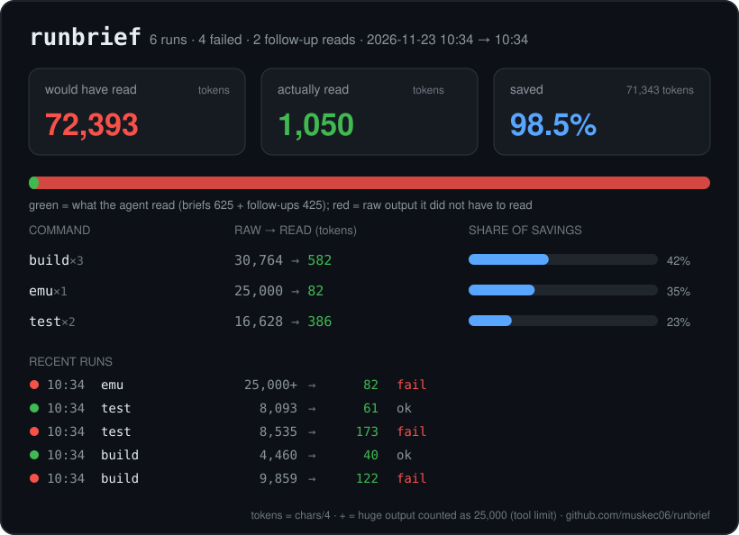

<div align="center">

# runbrief

**Gürültülü komutları çalıştır, yapay zekâ ajanına kısa bir özet ver.**

[](https://github.com/muskec06/runbrief/actions/workflows/ci.yml)


[](LICENSE)


[HD izle (MP4, 35 sn)](docs/runbrief-demo.mp4) · [English README](README.md)

</div>

`runbrief` bir derlemeyi, test paketini, emülatörü ya da simülatörü çalıştırır, tam çıktıyı
log dosyasına yazar ve ajana kök nedeni öne alan kısa bir özet verir. Ajan log'u yalnızca
özet yetmediğinde ve yalnızca gereken satırlar için açar.

Tek Python dosyası, bağımlılık yok, Python 3.10+, Linux / macOS / Windows. Claude (sohbet,
skill, Claude Code) ve kabuk komutu çalıştırabilen her ajanla çalışır.

---

## Neden

Kodlama ajanı her turda tüm konuşmayı yeniden okur. 600 satırlık ayrıntılı bir derleme logu
geldiği an bir kez, sonra oturumun her turunda tekrar token harcatır. Bu logun büyük kısmı
ilerleme satırları, derleyici komut satırları ve her derleme birimi için tekrarlanan aynı hatadır.
Ajanın gerçekten ihtiyacı olan genelde iki satırdır.

```text
$ runbrief -n build -- "make -C build VERBOSE=1 -k -j2"
[runbrief] build: FAIL exit=2 | 6.2s | 607 lines | errors 2 (74 hits) | warnings 0 | log .runbrief/logs/build-...-fail.log
errors (first-seen order, showing 2/2):
  L18: include/regs.h:5:59: error: 'MASK_ALL' was not declared in this scope  [x73]
  L502: src/periph/uart.cpp:6:68: error: 'baud_divisor' was not declared in this scope
build-system: 75 failure line(s), first L26: make[2]: *** [...op_000.cpp.o] Error 1
more: runbrief grep 'REGEX' -n build  |  runbrief show -n build -L <line> -C 20
```

Bu derlemenin ham çıktısı **16.638 token**, özeti **149 token**. Başlık dosyasındaki hatanın 73
kopyası sayaçlı tek satıra, 75 adet `make: *** Error` satırı tek bir "sonuç" satırına indi.
Böylece `uart.cpp`'deki ikinci, ilgisiz hata gözden kaçmıyor.

## Sonuçlar

[`bench/run_bench.py`](bench/run_bench.py) ile gerçek araç çıktıları üzerinde ölçüldü
(gcc 13.3, clang 18.1, CMake 3.28, GNU Make 4.3, ninja 1.11, pytest, Python 3.13; Linux, 2 CPU).
Her senaryo iki kez çalıştırıldı: ham ve runbrief üzerinden.
*Doğruluk* = geliştiricinin ihtiyaç duyduğu kök neden işaretlerinin (dosya:satır ya da mesaj)
özette bulunma oranı. Tüm özetler: [`bench/results/results.md`](bench/results/results.md).

| Senaryo | Ham satır | Ham token | Özet token | Azalma | Doğruluk |
|---|---:|---:|---:|---:|:-:|
| C++ emülatör, CMake + `make VERBOSE=1 -k`, iki hata | 607 | 16.638 | 149 | %99,1 | 2/2 |
| Aynı proje düzeltilmiş, `-Wall -Wextra`, `ninja -v` (başarılı) | 135 | 7.064 | 41 | %99,4 | 1/1 |
| clang++ şablon hataları | 96 | 2.739 | 254 | %90,7 | 3/3 |
| g++, aynı dosya | 54 | 1.599 | 197 | %87,7 | 3/3 |
| Linker: undefined reference | 3 | 39 | 52 | **-%34,8** | 1/1 |
| `pytest -v`, 400 test, 3 hata | 448 | 8.534 | 172 | %98,0 | 4/4 |
| Python emülatör yapılandırması: 800 log satırı, sonra `KeyError` | 811 | 12.519 | 77 | %99,4 | 2/2 |
| MSBuild / C#, 40 proje *(gerçek formatta kayıt, aşağıya bakın)* | 332 | 15.746 | 189 | %98,8 | 2/2 |
| Emülatör trace, 200 bin satır, ortada `FAULT` | 200.001 | 3.850.018 | 84 | >%99,99 | 1/1 |
| Aynı trace, hata satırında **hiç anahtar kelime yok** | 200.001 | 3.850.020 | 245 | >%99,99 | 1/1 |
| Aynısı, `.runbrief/patterns.txt`'ye bir satır eklenmiş | 200.001 | 3.850.020 | 88 | >%99,99 | 1/1 |
| Hiç bitmeyen simülatör, `-T 8`, 20 MB log sınırı | 4.120.002 | 60.770.012 | 85 | >%99,99 | 1/1 |

**Yalnızca derleme ve testler (ilk 8 satır): 64.878 → 1.131 token, %98,3 daha az. 12 senaryonun tamamında 22/22 kök neden işareti korundu.**

Oturum içindeki anlamı: yukarıdaki CMake hatası 10 tur daha context'te kalırsa ham hâliyle
yaklaşık 166.000, özet hâliyle yaklaşık 1.500 token olarak yeniden okunur (prompt önbelleği
indirimi hariç, basit çarpım).

Tabloyu doğru okumak için:

- **Token sayısı her iki sütunda da bayt / 4 olarak tahmin edildi.** Bu yüzden *azalma oranı*
  tahmin yönteminden bağımsız; belirli bir modelin tokenizer'ındaki mutlak sayılar farklı olur.
- **Çok küçük çıktılar biraz daha pahalı** (linker satırı): 40 satır / 4 KB altındaki çıktılar tek satırlık
  bir başlıkla olduğu gibi gösterilir, bu ~13 token ekler. Bilinçli bir tercih: hiçbir şey kaybolmaz.
- **Ek süre** derlemelerde ölçüm gürültüsü içinde kalıyor; satır yoğun trace'lerde satır başına
  1–2 µs (200 bin satırda +0,1 ile +0,4 sn).
- **MSBuild** satırı, MSBuild'in gerçek çıktı formatındaki bir kaydı tekrar oynatır (ortamda .NET SDK yoktu).
  Emülatör/simülatör satırları gerçekçi trace formatı üreten betiklerdir.
- Hepsini `python3 bench/run_bench.py` ile yeniden üretebilirsiniz; CI her push'ta çalıştırır.

## runbrief'in kendi maliyeti

Aracı kullanmak da bedava değil; kendi ayak izi (ölçülen dosya boyutları, bayt/4):

| Kullanım şekli | Sohbet başına tek seferlik | Sürekli |
|---|---|---|
| Prompt + `git clone` (sohbet) | `AGENTS.md` ≈ 1.020 token + klon/kurulum çıktısı ≈ 40 | yok |
| claude.ai skill | — | skill açıklaması her sohbette ≈ 70 token; kullanılınca `SKILL.md` ≈ 690 |
| Claude Code kurulumu | — | `CLAUDE.md` kuralları oturum başına ≈ 240 token (önbellekli); engellenen ham komut bir kısa tur ekler |

Kurallar ajana `runbrief.py`'yi (≈ 9.100 token) ve README'yi (≈ 5.400) **okumamasını**
söyler; betiği çalıştırmak için ikisine de gerek yok. Başa baş noktası ilk gürültülü komuttur:
yukarıdaki tek bir başarısız CMake derlemesi ≈ 1.060 token'lık kuruluma karşı ≈ 16.500 token kazandırır.

## Ajanın işini kötüleştirir mi?

Kötüleştirmemek için tasarlandı ve kıyaslama bunu ölçüyor:

- **Kök neden önce.** Hatalar ilk görüldükleri sırayla listelenir (genelde ilk hata asıl hatadır),
  tekrarlar `[x73]` ile sayılır. `make: ***`, `ninja: build stopped`, `Build FAILED`,
  `collect2: ld returned` gibi sonuç satırları ayrıca sayılır.
- **Gürültülü satır değil, işe yarayan satır.** `stl_algo.h` içinde raporlanan C++ şablon
  hatalarına sizin kodunuzdaki satır eklenir: `... error: no match for 'operator-' ... (from bus.cpp:11)`.
  Python traceback'leri, istisna mesajı ve standart kütüphane dışındaki son kod satırınızla tek satıra iner.
- **Hiçbir şey atılmaz.** Tam log diskte kalır; `runbrief grep` ve `runbrief show` tam
  gereken satırları getirir. Satır numaraları log kırpıldıktan sonra da tutarlıdır.
- **Bilinmeyen formatlar sessizce kaçmaz.** Hiçbir kalıp eşleşmezse özet sıkıştırılmış bir kuyruk
  ve "nadir satırlar" gösterir: büyük ve tekrarlı bir çıktıda en fazla iki kez görülen biçimdeki satırlar.
  Kıyaslamada bu yöntem, hiç hata kelimesi içermeyen 200.000 satırlık bir trace'te
  `uart0: unexpected register value CR1=0x0000DEAD` satırını buldu.
  `.runbrief/patterns.txt`'ye eklenen tek bir satır bunu tam bir hataya çevirir.
- **Küçük çıktılar değişmeden geçer**, böylece çıktısı cevabın kendisi olan komutlar da çalışır.

## Hızlı başlangıç

### Tarayıcıda veya uygulamada Claude (kod çalıştırmalı bulut sohbeti)

Yeni sohbetin ilk mesajı olarak yapıştırın:

```text
Before anything else: git clone --depth 1 --branch v1.1.0 https://github.com/muskec06/runbrief /tmp/runbrief
and follow /tmp/runbrief/AGENTS.md for this whole conversation (run its setup step).
Task: <göreviniz>
```

Ortamda GitHub erişimi yoksa `runbrief.py` ve `AGENTS.md` dosyalarını ekleyip şunu yazın:
*"Use the attached runbrief.py and follow AGENTS.md for this whole conversation."*

**Uzamış bir sohbetin ortasında mısınız?** [`PROMPT.md`](PROMPT.md) içindeki B prompt'unu kullanın:
o andan itibaren tasarruf başlar ve bir `HANDOFF.md` yazılır. Böylece yeni bir sohbete geçip eski
çıktıların hâlâ kapladığı yeri de geri kazanabilirsiniz.

Ya da [`dist/runbrief-skill.zip`](dist/runbrief-skill.zip) dosyasını bir kez skill olarak yükleyin
(Customize › Skills › + › Create skill › Upload a skill) ve sohbetlere *"Use the runbrief skill."* diye başlayın.
Prompt'lar İngilizce; Claude cevabı yine sizin dilinizde verir.

### Claude Code

```bash
python3 integrations/claude-code/install.py /proje/yolu   # Windows'ta sonuna --windows ekleyin
```

runbrief'i `.claude/runbrief/` klasörüne kurar, kuralları `CLAUDE.md`'ye ekler. Ayrıca şunları kurar:

- **Ham komutları engelleyen bir hook:** `make`, `cmake --build`, `ninja`, `msbuild`, `dotnet build/test`,
  `pytest`, `gcc`, `qemu-system-*`, `renode`, `west`, `idf.py`, `cargo build` gibi komutlar ham çalıştırılırsa
  engeller ve Claude'a bunları runbrief ile tekrar çalıştırmasını söyler. Çıktısı zaten sınırlanmış komutlar
  (`| tail`, `> file.log`), git komutları ve tırnak içindeki metinler engellenmez. Atlamak için komutun başına `RAW=1` ekleyin.
- **Context izleyici:** Context %50'yi geçince Claude'dan `HANDOFF.md`'yi güncellemesini ve `/compact`
  önermesini ister. Bu bir yedek, çünkü `CLAUDE_AUTOCOMPACT_PCT_OVERRIDE` birçok Claude Code sürümünde güvenilir çalışmıyor.
- **Durum satırı:** Context yüzdesini gösterir.
- **Okuma yasakları:** `build/`, `obj/`, `*.o`, `*.elf`, `*.map`, `*.pdb` ve log klasörü okunamaz.

Sonucu commit edin; bulut oturumları dahil her oturum bununla başlar.

### Diğer ajanlar veya düz kabuk

```bash
python3 runbrief.py install          # PATH'e `runbrief` komutunu ekler
runbrief -n build -- "cmake --build build -j8"
```
[`AGENTS.md`](AGENTS.md) içeriğini ajanınızın kural dosyasına ekleyin. Diğer prompt'lar: [`PROMPT.md`](PROMPT.md).

## Komutlar

| Komut | Ne yapar |
|---|---|
| `runbrief [-n AD] [-T SN] -- "<komut>"` | Çalıştırır, log'a yazar, özet basar. Çıkış kodu korunur (zaman aşımında 124). |
| `runbrief grep REGEX [-n AD] [-C 2] [-m 30]` | AD'ın son log'unda arar (veya `--log YOL`, `.gz` de olur). |
| `runbrief show -L SATIR [-n AD] [-C 20]` | Özetteki satır numarasının çevresini gösterir. |
| `runbrief stats [--svg DOSYA] [--since SAAT] [--json]` | Kazanç paneli (grep/show okumaları düşülmüş net) ya da paylaşılabilir SVG kart. |
| `runbrief clean` / `install [DİZİN]` | Logları siler / `runbrief`'i PATH'e kurar. |

## Linux komutları: neyi sarmalamalı, neyi değil

runbrief, *teşhis edilmesini* istediğiniz çıktı içindir. Çıktının kendisi cevapsa, komutun kendi
seçenekleriyle sınırlanmalıdır; yoksa özet onu gizler.

| runbrief ile çalıştırın | Kendi seçenekleriyle sınırlayın |
|---|---|
| `make`, `cmake --build`, `ninja`, `gcc`/`clang`, çekirdek modülü (`make -C /lib/modules/$(uname -r)/build M=$PWD`) | `cat`, `ls`, `tree`, `git diff/log/show`, `env`, `ps` |
| `pytest`, `ctest`, `dotnet test`, `npm test` | `grep -rn -m 50`, `rg -m 50`, `find . -maxdepth 3 \| head -100` |
| `apt-get install`, `dnf install`, `pip install`, `npm install`, `./configure`, `docker build` | `journalctl -p err -n 100 --no-pager`, `dmesg --level=err,warn \| tail -100` |
| `qemu-system-*`, `renode`, `west flash`, `idf.py`, kendi simülatörünüz (`-T SN`) | sonuç basan küçük bir betik |
| `valgrind`, ASan/UBSan çalıştırmaları, uzun betikler | |

Tanınan Linux hata satırları arasında şunlar var: `E: Unable to locate package`, `npm ERR!`, `fatal:` (git),
`configure: error`, `make: *** No rule to make target` (ardışık sonuç değil kök neden sayılır),
`command not found`, `No such file or directory`, `Permission denied`, `No space left on device`,
valgrind `Invalid read`/`definitely lost`, sanitizer raporları, çekirdek `BUG:`/`Oops:`/`Call Trace:`/`error -71`
ve systemd `Failed to start`. Büyük harfli işaretler (`FATAL`, `PANIC`, `FAULT`) büyük/küçük harfe duyarlı aranır;
bu yüzden bir listedeki `Fatal.pm` ya da `fault_handler.c` gibi dosya adları hata sayılmaz.
Okumanız gereken büyük çıktılar için `runbrief -n x -H 40 -- "<komut>"` ilk 40 satırı gösterir.

## Log politikası

Loglar, ajanın yavaş bir derlemeyi yeniden çalıştırmadan ayrıntıya inebilmesi için var.
Asla disk sorununa dönüşmemeliler.

| Kural | Varsayılan | Neden |
|---|---|---|
| Konum | Çalışma dizininde `.runbrief/logs/` (git'e girmez) | Projenin yanında, bulması ve silmesi kolay. |
| Log başına sınır | 100 MB; sonra ortası kesilir: ilk %10 ve son %40 kalır, yazma devam eder | Açılış ve son durum en önemlisi. Hatalar akış sırasında toplandığı için kesilen kısımdaki hatalar da özette olur. |
| Ad başına saklama | En yeni 1 başarılı + 5 başarısız log | Başarılı loglar nadiren okunur; son hatalar okunur. |
| Sıkıştırma | Her addaki en yeni log dışındakiler gzip'lenir | Derleme logları ~20 kat, trace'ler ~6 kat küçülür (kıyaslama: 14,7 MB → 2,3 MB). |
| Klasör sınırı | 300 MB, önce en eskiler silinir | Kesin tavan. Varsayılanlarla en kötü durum ~200 MB. |
| Bitmeyen programlar | `-T SN` tüm süreç ağacını kapatır | Simülatör sonsuza kadar çalışıp log yazamaz. |

Loglar araçlarınızın bastığı yolları, ortam bilgilerini veya gizli bilgileri içerebilir; yereldir ve
commit edilmez. Paylaşmadan önce kontrol edin.

## İstatistik

`runbrief` her çalıştırma için `.runbrief/stats.jsonl` dosyasına tek satırlık bir JSON kaydı tutar
ve istendiğinde bunu bir panele dönüştürür. `grep`/`show` ile yapılan log okumaları, inceledikleri
komutun hanesine yazılır; yani gösterilen kazanç **net**tir.



Yukarıdaki kart gerçektir: gerçekten çalıştırılmış 8 adımlı bir hata ayıklama oturumundan
([`bench/session_demo.py`](bench/session_demo.py)) üretildi: iki hatalı derleme, ilk hataya bakma,
düzeltme, yeniden derleme, düzeltme, başarılı derleme, 3 hatalı test, bir hatayı arama, düzeltme,
başarılı testler, emülatör çalıştırma. Aynı veri terminalde:

```text
$ runbrief stats
runbrief stats | 6 runs (4 failed) | 2 follow-up reads | 2026-11-23 10:34 → 10:34
────────────────────────────────────────────────────────────────────────
  would have read         72,393 tokens   (raw output; 1 huge run(s) counted as 25,000)
  actually read            1,050 tokens   (briefs 625 + follow-ups 425)
  saved                   71,343 tokens
  ███████████████████████████████████████████████████▎  98.5% saved

  command      runs    raw tokens     read    saved   share of savings
  build           3        30,764      582    98.1%   ███████▋··········   42%
  emu             1        25,000       82    99.7%   ██████▎···········   35%
  test            2        16,628      386    97.7%   ████▏·············   23%

  recent runs
   ✗ 10:34  emu               25,000+→    82 tokens  fail
   ✓ 10:34  test               8,093 →    61 tokens  ok
   ✗ 10:34  test               8,535 →   173 tokens  fail
   ✓ 10:34  build              4,460 →    40 tokens  ok
   ✗ 10:34  build              9,859 →   122 tokens  fail
   ✗ 10:34  build             16,445 →   147 tokens  fail
────────────────────────────────────────────────────────────────────────
  + capped at 25,000 tokens per run (an agent's tool-output limit); uncapped raw total 3,897,411
  logs 14.74 MB in 6 file(s) | tokens = chars/4 | runbrief stats --svg card.svg
```

- **Dürüst sayım:** Bir ajan tek bir komutun çıktısından, aracının çıktı sınırından fazlasını asla okumaz.
  Bu yüzden her çalıştırmanın ham çıktısı en fazla **25.000 token** sayılır (`RUNBRIEF_STATS_CAP_TOKENS`,
  `0` = sınırsız). Yukarıdaki 200.000 satırlık emülatör trace'i 3,85 milyon değil 25.000 sayılır;
  sınırsız toplam yine de yazdırılır.
- Bu oturumda yalnızca derleme ve testler: tüm log okumaları dahil ~47.392 → ~968 token: **net %98,0**.
- `runbrief stats --svg kart.svg` kartı yazar (bağımsız SVG; README'ye ya da PR'a eklenebilir),
  `--since 8` son 8 saatle sınırlar, `--json` ham sayıları verir, `--reset` sıfırlar.
  Unicode desteklemeyen konsollar için `RUNBRIEF_ASCII=1`. Kayıt çalıştırma başına birkaç bayttır;
  `RUNBRIEF_STATS=0` ile kapatılır. Ajan `stats`'ı yalnızca siz isteyince çalıştırır.

## Ayarlar

| Değişken | Varsayılan | |
|---|---|---|
| `RUNBRIEF_DIR` | `./.runbrief` | Loglar, istatistik, kalıplar |
| `RUNBRIEF_MAX_MB` / `_HEAD_PCT` / `_TAIL_PCT` | 100 / 10 / 40 | Log sınırı ve kırpmada kalan kısımlar |
| `RUNBRIEF_KEEP_OK` / `_KEEP_FAIL` | 1 / 5 | Ad başına saklanan log |
| `RUNBRIEF_DIR_MAX_MB` | 300 | Klasör sınırı |
| `RUNBRIEF_GZIP` | 1 | Eski logları sıkıştır |
| `RUNBRIEF_PASSTHROUGH_LINES` / `_BYTES` | 40 / 4000 | Bunun altında çıktı olduğu gibi basılır |
| `RUNBRIEF_ERR` / `RUNBRIEF_WARN` | - | Ek regex (ya da `.runbrief/patterns.txt`, uyarılar için `W:` öneki) |
| `RUNBRIEF_STATS` | 1 | İstatistik kaydı |
| `RUNBRIEF_STATS_CAP_TOKENS` | 25000 | `stats`'ta çalıştırma başına sayılan en fazla ham token (0 = sınırsız) |
| `RUNBRIEF_ASCII` | - | Yalnızca ASCII `stats` çıktısı |

Hazır tanınanlar: gcc/clang, MSVC (`C####`, `LNK####`), C#/MSBuild/NuGet (`CS####`, `MSB####`, `NU####`),
GNU ld / lld, CMake, make, ninja, Python traceback, pytest, Rust tarzı `error[...]`, segfault, assertion, panic, `FATAL`/`FAULT`.

## Riskler ve önlemler

| Risk | Önlem |
|---|---|
| **Tedarik zinciri:** Prompt, GitHub'dan kod klonlayıp çalıştırıyor; repo değişirse her yeni oturum yeni kodu çalıştırır. | Prompt'lar bir sürüm etiketine sabitlenir (`--branch v1.1.0`). Prompt'taki etiketi değiştirmeden önce sürümü inceleyin; repoda 2FA ve dal korumasını açın. |
| **Repodaki talimatlar ajanı yönlendirir.** `AGENTS.md` talimat olarak okunur. | Aynı sabitleme; dosya kısa, düz metin ve kolay incelenir. |
| **Ajan bilgi kaçırır**, çünkü özet okur. | Kıyaslamada 22/22 kök neden korundu; tam log diskte (`grep`/`show`); bilinmeyen formatlara kuyruk ve nadir satır ipucu; küçük çıktılar olduğu gibi geçer. |
| **Gizlenen cevap:** Çıktısı cevap olan bir komutun sarmalanması. | Kurallar hangi komutların sarmalanmayacağını söyler; her başarılı özet çıktının nasıl okunacağını yazar; `-H N` ilk satırları basar. |
| **Logların yanlışlıkla commit edilmesi ya da gizli bilgi sızması.** | `.runbrief/` kendi `.gitignore`'unu içerir (yalnızca `patterns.txt` commit edilebilir). Loglar yereldir; araçlar içine token ya da yol basabilir, paylaşmadan önce kontrol edin. |
| **Disk kullanımı.** | Log başına 100 MB (baş/son korunur), ad başına 1 başarılı + 5 başarısız, gzip, 300 MB klasör sınırı. |
| **Hiç bitmeyen program** ajanı bekletir. | `-T SN` tüm süreç ağacını kapatır (çıkış 124). `-T` yoksa ajanın kendi komut zaman aşımı geçerlidir. |
| **Etkileşimli komutlar.** | stdin kapalıdır: soru soran komutlar dosya sonu alır. Etkileşimsiz seçenekler kullanın (`-y`, `--batch`). Renk/ilerleme çubukları temizlenir. |
| **Uzun sohbette kuralların unutulması** (context özetlendikten sonra). | `HANDOFF.md` "Session uses runbrief" ile başlar; ajan emin değilse kısa `AGENTS.md`'yi yeniden okur; skill ve Claude Code hook'ları kendiliğinden yeniden devreye girer. |
| **Çalışma ortamının sıfırlanması** (uzun aradan sonra bulut sohbeti). | Ajan `runbrief` bulunamazsa klonlama/kurulum adımını yeniden çalıştırır. |
| **Claude Code hook'unun yanlış engellemesi.** | Tırnak içindeki metinler, git komutları ve zaten sınırlanmış komutlar geçer; atlamak için `RAW=1` öneki. |

## Sınırlar

- Yalnızca **komut çıktısını** azaltır. Dosya okumaları, uzun sohbetler ve modelin düşünmesi ayrı
  maliyetlerdir; `AGENTS.md` bunlar için alışkanlıklar ekler (dar okuma, `HANDOFF.md`, yeni oturum).
- Kalıp tabanlıdır: tanınabilir hiçbir şey basmayan ve çıktısında "nadir" de olmayan bir hata yalnızca
  kuyrukta görünür. Böyle bir durum görünce bir kalıp ekleyin.
- Nadir satır ipucu sezgiseldir; bir çıktıda 60'tan fazla nadir biçim varsa sessiz kalır.
- Büyük çıktısı zaten ajanın okumasını istediğiniz sonuç olan komutları runbrief ile çalıştırmayın.

## Geliştirme

```bash
python3 -m pytest -q tests/        # birim testleri (29)
python3 bench/run_bench.py         # kıyaslama -> bench/results/
python3 bench/session_demo.py      # gerçek oturum demosu
python3 tools/build_skill.py       # skill zip'ini yeniden üret
python3 docs/video/make_video.py docs/video/raw-build.txt docs/video/brief-build.txt /tmp/out   # demo videosu
```

## Yazar

[@muskec06](https://github.com/muskec06) tarafından, derleme loglarının yapay zekâ kullanım
kotasını tükettiği bir emülatör projesi (çevre birimi ayarları, sürücü simülasyonu, C/C++, C# ve
Python derlemeleri) üzerinde çalışırken geliştirildi. Issue ve pull request'ler açıktır; yeni hata
formatları en iyi bir kalıp ve `tests/` altında bir test ile eklenir.

MIT lisansı.
