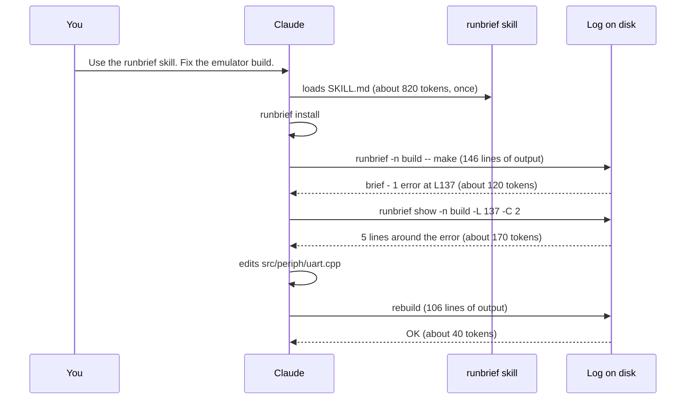
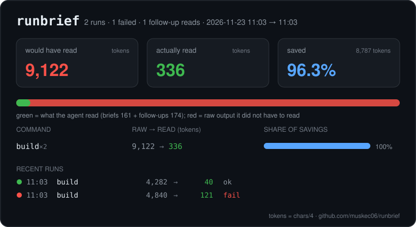

# Using runbrief as a Claude skill: a real example

Everything below was executed on 2026-11-23 with the skill file shipped in this repository
([`dist/runbrief-skill.zip`](../dist/runbrief-skill.zip)), unpacked exactly as claude.ai unpacks it.
The commands and outputs are verbatim (home paths shortened to `~`). Only the chat messages
("You", "Claude") describe what happens around them.

## 1. Install the skill once

1. In Claude: **Settings › Capabilities**, make sure *Code execution and file creation* is on.
2. **Customize › Skills › + › Create skill › Upload a skill**, choose `runbrief-skill.zip`.
3. That's it. The skill's short description (about 70 tokens) is visible to Claude in every chat;
   the full instructions (about 820 tokens) are loaded only when a build, test or simulator
   run comes up.

## 2. Start a chat

> **You:** Use the runbrief skill. The emulator build in `~/emu` fails, fix it.

Saying "use the runbrief skill" is optional; it makes sure the skill is picked even if the
request does not mention building.



## 3. What Claude actually ran and saw

**Setup** (once per conversation, from SKILL.md):

```text
$ python3 $CLAUDE_SKILL_DIR/scripts/runbrief.py install
[runbrief] installed: ~/.local/bin/runbrief
```

**Build.** The raw output is 146 lines (about 4,840 tokens); Claude receives this instead:

```text
$ runbrief -n build -- "make -C build VERBOSE=1 -j2"
[runbrief] build: FAIL exit=2 | 6.4s | 146 lines | errors 1 | warnings 0 | log .runbrief/logs/build-20261123-110326-463-fail.log
errors (first-seen order, showing 1/1):
  L137: src/periph/uart.cpp:6:68: error: ‘baud_divisor’ was not declared in this scope
build-system: 4 failure line(s), first L140: make[2]: *** [CMakeFiles/emu.dir/build.make:916: CMakeFiles/emu.dir/src/periph/uart.cpp.o] Error 1
more: runbrief grep 'REGEX' -n build  |  runbrief show -n build -L <line> -C 20
```

**Drill down.** Claude takes the line number from the brief and reads only the lines around it,
including the compiler's caret under the bad identifier:

```text
$ runbrief show -n build -L 137 -C 2
[runbrief] .runbrief/logs/build-20261123-110326-463-fail.log: lines 135-139
  L135- /usr/bin/c++  -I~/emu/include -std=gnu++17 -MD -MT CMakeFiles/emu.dir/src/periph/spi.cpp.o -MF CMakeFiles/emu.dir/src/periph/spi.cpp.o.d -o CMakeFiles/emu.dir/src/periph/spi.cpp.o -c ~/emu/src/periph/spi.cpp
  L136- ~/emu/src/periph/uart.cpp: In function ‘void uart_write(uint32_t, uint32_t)’:
  L137: ~/emu/src/periph/uart.cpp:6:68: error: ‘baud_divisor’ was not declared in this scope
  L138-     6 | void uart_write(uint32_t addr, uint32_t v) { uart_mmio[addr] = v + baud_divisor; }
  L139-       |                                                                    ^~~~~~~~~~~~
```

**Fix.** Claude edits src/periph/uart.cpp line 6 with its file-edit tool: removes the undefined `+ baud_divisor`

**Rebuild.** Success is one line; the 106 lines stay in the log (and the brief says how to read them):

```text
$ runbrief -n build -- "make -C build VERBOSE=1 -j2"
[runbrief] build: OK | 1.1s | 106 lines | errors 0 | warnings 0 | log .runbrief/logs/build-20261123-110332-989-ok.log | read: runbrief show -n build -L 1 -C 40
```

**Savings** (Claude runs this only when you ask, e.g. "how many tokens did runbrief save?"):

```text
$ runbrief stats
runbrief stats | 2 runs (1 failed) | 1 follow-up reads | 2026-11-23 11:03 → 11:03
────────────────────────────────────────────────────────────────────────
  would have read          9,122 tokens   (raw output of every command)
  actually read              336 tokens   (briefs 161 + follow-ups 174)
  saved                    8,787 tokens
  ██████████████████████████████████████████████████▏·  96.3% saved

  command      runs    raw tokens     read    saved   share of savings
  build           2         9,122      336    96.3%   ██████████████████  100%

  recent runs
   ✓ 11:03  build              4,282 →    40 tokens  ok
   ✗ 11:03  build              4,840 →   121 tokens  fail
────────────────────────────────────────────────────────────────────────
  logs 0.02 MB in 2 file(s) | tokens = chars/4 | runbrief stats --svg card.svg
```

The same data as a card (`runbrief stats --svg card.svg`):



## 4. What to notice

- The build output never entered the conversation; 336 tokens did, instead of 9,122.
- The follow-up read (`show`) is counted in the statistics, so 96.3% is a **net** figure.
- This is a small project with one bug. Savings grow with output size: the 607-line build in the
  [benchmark](../bench/results/results.md) goes from 16,638 to 149 tokens.
- In a long conversation the skill keeps working after the chat is summarised, because Claude
  reloads it by its description whenever builds or tests come up.
