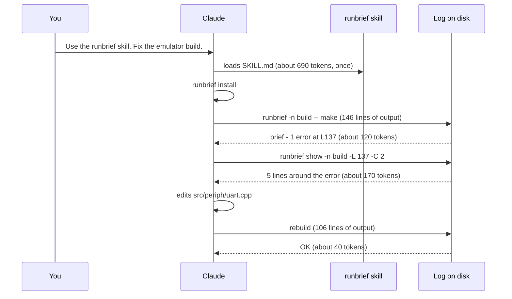
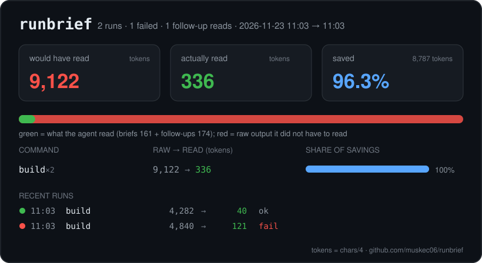

# runbrief'i Claude skill'i olarak kullanmak: gerçek bir örnek

Aşağıdaki her şey 2026-11-23'te, bu repodaki skill dosyasıyla
([`dist/runbrief-skill.zip`](../dist/runbrief-skill.zip)) ve claude.ai'nin açtığı şekilde açılarak
gerçekten çalıştırıldı. Komutlar ve çıktılar birebir aynıdır (ev dizini `~` olarak kısaltıldı).
Yalnızca sohbet mesajları ("Siz", "Claude") etraftaki akışı anlatır.

## 1. Skill'i bir kez yükleyin

1. Claude'da **Settings › Capabilities** altında *Code execution and file creation* açık olsun.
2. **Customize › Skills › + › Create skill › Upload a skill** ile `runbrief-skill.zip` dosyasını seçin.
3. Bu kadar. Skill'in kısa açıklaması (yaklaşık 70 token) her sohbette Claude'a görünür; tam talimatlar
   (yaklaşık 690 token) yalnızca derleme, test ya da simülatör çalıştırılacağı zaman yüklenir.

## 2. Sohbeti başlatın

> **Siz:** Use the runbrief skill. The emulator build in `~/emu` fails, fix it.

"Use the runbrief skill" demek isteğe bağlıdır; istek derlemeden söz etmese bile skill'in seçilmesini sağlar.
İsteği Türkçe de yazabilirsiniz.



## 3. Claude'un gerçekte çalıştırdıkları ve gördükleri

**Kurulum** (sohbet başına bir kez, SKILL.md'den):

```text
$ python3 $CLAUDE_SKILL_DIR/scripts/runbrief.py install
[runbrief] installed: ~/.local/bin/runbrief
```

**Derleme.** Ham çıktı 146 satır (yaklaşık 4.840 token); Claude bunun yerine şunu görür:

```text
$ runbrief -n build -- "make -C build VERBOSE=1 -j2"
[runbrief] build: FAIL exit=2 | 6.4s | 146 lines | errors 1 | warnings 0 | log .runbrief/logs/build-20261123-110326-463-fail.log
errors (first-seen order, showing 1/1):
  L137: src/periph/uart.cpp:6:68: error: ‘baud_divisor’ was not declared in this scope
build-system: 4 failure line(s), first L140: make[2]: *** [CMakeFiles/emu.dir/build.make:916: CMakeFiles/emu.dir/src/periph/uart.cpp.o] Error 1
more: runbrief grep 'REGEX' -n build  |  runbrief show -n build -L <line> -C 20
```

**Ayrıntıya inme.** Claude özetteki satır numarasını alır ve yalnızca çevresini okur; derleyicinin
hatalı tanımlayıcının altına koyduğu `^~~~` işareti de dahil:

```text
$ runbrief show -n build -L 137 -C 2
[runbrief] .runbrief/logs/build-20261123-110326-463-fail.log: lines 135-139
  L135- /usr/bin/c++  -I~/emu/include -std=gnu++17 -MD -MT CMakeFiles/emu.dir/src/periph/spi.cpp.o -MF CMakeFiles/emu.dir/src/periph/spi.cpp.o.d -o CMakeFiles/emu.dir/src/periph/spi.cpp.o -c ~/emu/src/periph/spi.cpp
  L136- ~/emu/src/periph/uart.cpp: In function ‘void uart_write(uint32_t, uint32_t)’:
  L137: ~/emu/src/periph/uart.cpp:6:68: error: ‘baud_divisor’ was not declared in this scope
  L138-     6 | void uart_write(uint32_t addr, uint32_t v) { uart_mmio[addr] = v + baud_divisor; }
  L139-       |                                                                    ^~~~~~~~~~~~
```

**Düzeltme.** Claude `src/periph/uart.cpp` dosyasının 6. satırını kendi dosya düzenleme aracıyla düzeltir: tanımsız `+ baud_divisor` kısmını siler.

**Yeniden derleme.** Başarı tek satırdır; 106 satır log'da kalır (özet nasıl okunacağını da yazar):

```text
$ runbrief -n build -- "make -C build VERBOSE=1 -j2"
[runbrief] build: OK | 1.1s | 106 lines | errors 0 | warnings 0 | log .runbrief/logs/build-20261123-110332-989-ok.log | read: runbrief show -n build -L 1 -C 40
```

**Kazanç** (Claude bunu yalnızca siz sorunca çalıştırır, örneğin "runbrief kaç token kazandırdı?"):

```text
$ runbrief stats
runbrief stats | 2 runs (1 failed) | 1 follow-up reads | 2026-11-23 11:03 → 11:03
────────────────────────────────────────────────────────────────────────
  would have read          9,122 tokens   (raw output of every command)
  actually read              336 tokens   (briefs 161 + follow-ups 174)
  saved                    8,787 tokens
  ██████████████████████████████████████████████████▏·  96.3% saved

  command      runs    raw tokens     read    saved   share of savings
  build           2         9,122      336    96.3%   ██████████████████  100%

  recent runs
   ✓ 11:03  build              4,282 →    40 tokens  ok
   ✗ 11:03  build              4,840 →   121 tokens  fail
────────────────────────────────────────────────────────────────────────
  logs 0.02 MB in 2 file(s) | tokens = chars/4 | runbrief stats --svg card.svg
```

Aynı veri kart olarak (`runbrief stats --svg kart.svg`):



## 4. Dikkat edilecekler

- Derleme çıktısı sohbete hiç girmedi; 9.122 yerine 336 token girdi.
- Sonradan yapılan log okuması (`show`) istatistiğe dahil; yani %96,3 **net** bir rakam.
- Bu, tek hatalı küçük bir proje. Kazanç çıktı büyüdükçe artar: [kıyaslamadaki](../bench/results/results.md)
  607 satırlık derleme 16.638 token'dan 149 token'a iner.
- Uzun bir sohbette, sohbet özetlendikten sonra da skill çalışmaya devam eder; çünkü Claude derleme ya da
  test konusu açıldıkça skill'i açıklamasından yeniden yükler.
